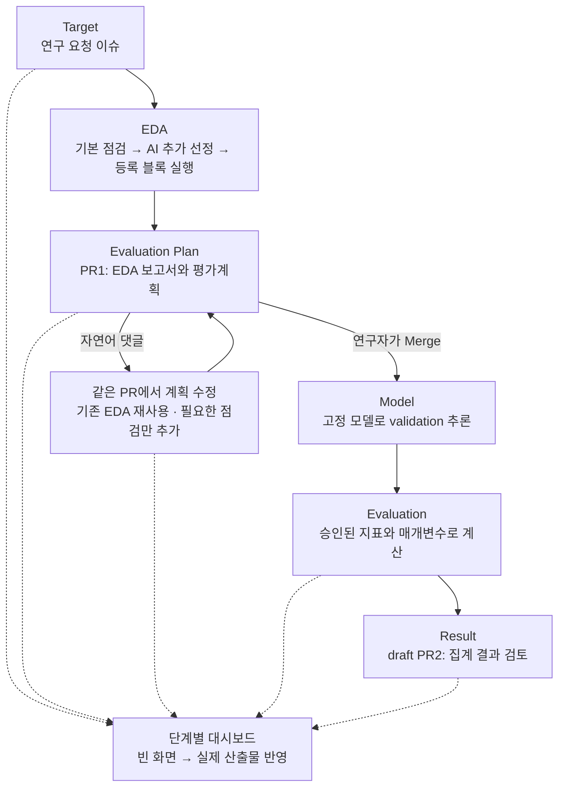

# Medical ML SDLC Workshop

### 주의

이 샘플은 의료 ML의 연구·검토 과정을 실습하기 위해 준비했습니다. 실제 진료나 임상 의사결정에 사용하지 마세요.
실행이 성공하거나 결과 PR이 만들어져도 모델의 임상적 유효성이 검증된 것은 아닙니다.

이미 전처리·분할된 공개 Diabetes 데이터와 대응 모델을 사용합니다. 새 학습·전처리·재분할은 하지 않습니다.
환자 중복과 validation의 개발 사용 이력이 있으므로 독립 검증 성능으로 해석할 수 없습니다.

연구자가 GitHub 이슈에 목적과 질문을 남기면, 기본 EDA를 먼저 실행하고 Copilot이 추가로 볼 점검과 평가 지표를 제안합니다.
연구자는 PR과 댓글에서 분석 범위를 조정하고 계획을 승인합니다. 승인된 계획으로 고정 모델을 평가한 뒤 결과를 별도 PR에서 검토합니다.

**Copilot은 제안과 자연어 해석을, Python은 계약 검증과 실제 계산을 담당합니다.**
무엇을 계산했는지, 무엇을 재사용했는지, 무엇은 확인할 수 없는지를 함께 남깁니다.
대시보드는 처음에는 비어 있고, 각 단계의 실제 산출물이 생기면 해당 내용만 채워집니다.

## 워크숍 목적

이 워크숍은 모델의 성능 수치만 확인하는 데 그치지 않고,
**연구의 목적·계획·피드백·확정·실행 결과를 서로 연결해 남기는 과정**을 경험하는 데 목적이 있습니다.
GitHub의 이슈·PR·Actions를 사용해 다음 네 가지 질문을 검토합니다.

| 과정 | 검토할 질문 | 남기는 기록 |
|---|---|---|
| 연구 목적 정하기 | 무엇을 예측하고, 어떤 결과를 좋다고 판단할까요? | 이슈의 연구 목표·질문·분석 대상 |
| 데이터 점검하기 | 연구 질문에 맞는 데이터인가요? 결측·오류·분리 기준이 분석을 왜곡하지 않나요? | EDA 집계와 확인된 문제·확인할 수 없는 항목 |
| 평가계획 검토하기 | AI의 추천을 받아 어떤 지표와 조건으로 평가할까요? | PR1의 계획·변경 이유·댓글 피드백·Merge |
| 실행 결과 해석하기 | 목적에 맞는 결과인가요? 수치와 그래프를 어디까지 해석할 수 있나요? | 실제 실행 출처·집계 결과·해석 한계·PR2 검토 |

예를 들어 양성 사례를 놓치지 않는 것이 중요한 연구라면, 그 목적이 지표 선택과 결과 해석에 어떻게 이어지는지 살펴봅니다.
AI의 제안을 그대로 확정하지 않고 연구자가 검토하고 필요한 조건을 수정합니다.

각 단계에서는 **무엇을 검토했는지, 누가 확정했는지, 어떤 입력 버전·코드·조건으로 실행했는지**를 함께 남깁니다.
반복 점검의 부담을 줄이고 평가 기준을 분명히 하며, 나중에 판단과 실행 이력을 다시 확인하는 방법을 익힙니다.

**기록과 승인은 데이터 누수 방지, 연구 타당성 또는 임상적 유효성을 보장하지 않습니다.**
이 흐름은 워크숍의 학습 목적이며, 실제 지원 범위와 데이터의 한계는 아래 구현 설명에서 구분합니다.

## 파이프라인



| 단계 | 워크플로 | 트리거 | 산출물 |
|---|---|---|---|
| 1. 접수 | `prepare-eda-pr.yml` | 연구 요청 이슈 등록 · 수동 | 권한과 폼을 확인한 정확한 분석 대상 |
| 2. EDA·계획 | `research-plan.md` | 접수 완료 · 수동 | 기본·추가 EDA, 평가계획, 첫 draft PR1 |
| 3. 계획 수정 | `review-eval-plan.yml` → `research-plan.md` | PR1에 자연어 댓글 | 같은 PR의 선택·계획·보고서 갱신 |
| 4. 추론·평가 | `evaluate-model.yml` | PR1 Merge · 수동 | `evaluation.json`, `report.md`, Actions Summary |
| 5. 결과 검토 | `publish-evaluation.yml` | 평가 성공 | 집계 결과 두 파일의 draft PR2 |
| 6. 화면 갱신 | `update-dashboard.yml` | 관련 실행 완료 · 수동 | `dashboard-data` 브랜치와 대시보드 artifact |

PR1은 연구자가 검토하고 Merge합니다. PR2도 검토용으로 만들 뿐 자동으로 승인하거나 Merge하지 않습니다.
계획 Merge는 교육용 계산의 실행 승인이지 임상 사용 승인이 아닙니다.
**현재 대시보드는 Actions와 연결되어 있으며, GitHub Pages 배포는 포함하지 않습니다.**

### 1. 접수

`연구 요청` 이슈 폼에 연구 목표, 질문, 분석 대상과 추가 요청을 남깁니다.
같은 저장소에 쓰기 권한이 있는 사람의 요청만 처리하며, 폼과 공개 데이터 사용 확인을 검사합니다.
이 단계는 대상을 전달할 뿐 모델을 실행하지 않습니다.

### 2. EDA·계획

기본 EDA를 먼저 계산합니다. Copilot은 그 집계를 읽고 **아직 실행하지 않은 점검만** 추가로 제안합니다.
등록된 Python 블록이 추가 점검을 실행한 뒤, 전체 EDA를 근거로 평가 지표를 추천하고 첫 PR1을 만듭니다.

점검은 스키마·환자 중복·인구통계·코호트·예측 시점·라벨 관찰가능성·전처리 계보의 7개 블록으로 구성합니다.
평가 지표는 별도 카탈로그의 15개 블록에서 선택합니다.
자료가 부족한 항목을 통과로 바꾸거나 임상적 의미를 추측하지 않습니다.

### 3. 계획 수정

PR1에 평소 문장으로 요청을 남기면 Actions의 **GitHub Copilot CLI**가 해석하고 같은 PR에 반영합니다.
별도의 `/plan` 명령이나 `@copilot` 멘션은 필요하지 않습니다. Cloud agent로 댓글 처리를 바꾸지는 않았습니다.

지표나 threshold만 바뀌면 검증된 EDA를 재사용합니다. 새 점검이 필요한 경우에만 해당 블록을 계산합니다.
Python은 허용된 ID·값·입출력 계약을 확인하며, 댓글을 코드로 실행하지 않습니다.

다음은 교육용 연결 검증에 사용한 요청 형태입니다.

> 기존 EDA는 유지하고 F1·Recall·Precision을 추가해 주세요. 주지표는 AP로 하고,
> threshold는 교육용 데모 값 0.5를 사용해 주세요. 새로 계산한 점검과 재사용한 점검을 구분해 알려주세요.

`0.5`는 임상 표준이나 최적값이 아닙니다. 필요한 값이 빠졌다면 차단·대기 사유를 남깁니다.
현재 지시문은 AI가 사람 대신 주지표·임계값·임상 행동을 확정하지 못하게 합니다.
실행이 성공했더라도 요청한 선택과 값이 실제 계획에 들어갔는지 확인해야 합니다.

### 4. 추론·평가

연구자가 PR1을 Merge하면 저장된 계획을 계약으로 삼아 고정 모델을 실행합니다.
데이터·모델의 digest, 파일 hash, 특성 이름과 순서, 클래스와 행 연결을 검사한 뒤 `predict_proba`를 호출합니다.
평가 지표는 기존 Python Executor가 계산합니다.

자동 평가는 **validation 15,265행**만 사용합니다. test는 정확한 Merge PR을 지정한 수동 실행에서만 선택할 수 있습니다.
모델 저장 환경에 맞춰 **Python 3.11 / scikit-learn 1.2.2**를 사용하며 추가 scaler나 학습을 적용하지 않습니다.
계획 당시의 코드·자산·입력 계약과 현재 실행이 다르면 멈춥니다.

산출물은 집계 JSON과 Markdown 보고서 두 개입니다. 환자별 확률·정답·키·특성 벡터는 게시하지 않습니다.
**EDA의 `failed`는 점검 기준 위반을 뜻하며 추론 프로그램의 실패와는 별개입니다.**

### 5. 결과 검토

별도 publisher가 정확한 평가 workflow의 성공·run/attempt·artifact 출처를 확인하고 draft PR2를 만듭니다.
저장된 계획·데이터·모델·집계가 서로 맞는지 다시 검사하며, 모델이나 지표를 재실행하지 않습니다.

같은 결과를 재게시하면 기존 PR을 재사용하고 불필요한 커밋을 만들지 않습니다.
사람이 쓴 제목·메모·검토 상태를 보존하며, 닫히거나 Merge된 결과 PR을 임의로 다시 열지 않습니다.
이 검사는 다른 AI 모델의 독립 검증이나 임상 성능 인증을 뜻하지 않습니다.

### 6. 화면 갱신

대시보드는 Target·EDA·Evaluation Plan·Model·Evaluation·Result의 6개 화면으로 구성합니다.
처음에는 레이아웃과 대기 상태만 보이고, 아직 없는 수치나 차트를 만들지 않습니다.
Issue 접수, PR1 게시·수정, 실제 평가, PR2 게시가 완료될 때 공개 집계를 받아 채웁니다.

새 Issue는 이전 Issue의 평가 결과와 섞지 않습니다.
Issue별 스냅샷을 따로 보관하고, 이전 실행의 늦은 완료가 새 Issue의 화면을 덮어쓰지 않게 합니다.
Evaluation에는 계산된 지표를, Result에는 전체 지표와 실제 calibration 집계를 표시합니다.
좌표가 없는 ROC·PR 곡선이나 산출하지 않은 하위집단 성능을 가짜 그래프로 채우지 않습니다.

공개 저장소용 화면은 토큰 없이 공개 스냅샷을 처음 열 때와 60초 간격으로 읽습니다.
조회가 실패하면 마지막 정상 집계와 오류 상태를 표시하며, 모델 실행이나 PR 승인 기능은 제공하지 않습니다.
비공개 저장소는 Actions artifact에 포함된 오프라인 집계를 사용합니다.

## 데이터 보호

준비된 공개 데이터와 모델 파일은 공통 GHCR의 고정 digest로 읽습니다.
GHCR은 파일을 보관하는 레지스트리입니다. 연구 실행 중 PostgreSQL 서버나 외부 DB 포트를 열지 않고 필요한 파일만 추출합니다.

원자료·환자 키·개별 정답·확률·특성 벡터는 runner의 임시 경로와 메모리에서만 사용합니다.
PR·Actions artifact·대시보드에는 집계와 실행 출처만 남깁니다.
대시보드 갱신도 등록된 workflow와 같은 저장소의 Issue·PR·계획·데이터 연결을 확인합니다.
브라우저에 GitHub 토큰을 넣지 않습니다.

### 데이터와 해석 범위

| 항목 | 현재 기준 |
|---|---|
| 데이터 | 공개 Diabetes 입원 데이터. train 71,236 / validation 15,265 / test 15,265행 |
| 입력·모델 | 이미 준비된 113개 숫자 특성과 대응 LogisticRegression |
| 정답 | 30일 이내 재입원 `<30`은 1, `>30`·`NO`는 0 |
| 고정 참조 | [`config/assets.json`](config/assets.json)의 공통 데이터·모델 digest |
| 출처·라이선스 | [`data/NOTICE.txt`](data/NOTICE.txt), [`config/prepared-source.json`](config/prepared-source.json) |

환자 중복을 숨기기 위해 재분할하지 않습니다. 다음 한계는 보고서와 대시보드에서도 유지합니다.

| 항목 | 해석 시 주의할 점 |
|---|---|
| 환자 중복 | train–validation 5,055명, train–test 5,086명, validation–test 1,760명 |
| validation | 공개 모델 개발에 사용됐으므로 독립 holdout이 아닙니다 |
| 인종 결측 | 원본 결측과 공개 sidecar의 대치값을 구분합니다 |
| 전처리 이력 | 과거 113-feature 변환과 split 전 target encoding의 한계가 남아 있습니다 |
| 임상 사용 | 입력의 임상적 의미·예측 시점·추적 완전성과 실제 활용 적합성은 별도 검토가 필요합니다 |

## 시작하기

이 저장소를 복사해 실습 저장소를 만든 뒤 다음 순서로 진행하세요.
참가자별 GHCR 복제는 필요하지 않으며, 현재는 등록된 공통 고정 자산을 사용합니다.

1. **Settings → Actions → General → Workflow permissions**에서
   **Allow GitHub Actions to create and approve pull requests**를 활성화합니다.
2. Copilot을 실행하는 계정의 이용 권한과 조직의 모델 정책을 확인합니다.
   Actions의 기본 `GITHUB_TOKEN`을 사용하므로 별도 PAT나 LLM Secret을 등록하지 않습니다.
3. **Actions → Update stage dashboard → Run workflow**를 실행합니다.
   `issue_number`를 비우면 빈 대시보드를 준비합니다. 이미 있는 진행 결과를 지우지는 않습니다.
4. 완료한 실행의 `stage-dashboard-{run}-{attempt}` artifact를 내려받아 전체 폴더를 풀고 `index.html`을 엽니다.
   이 화면은 공개 저장소의 후속 스냅샷을 읽어 갱신됩니다.
5. **Issues → New issue → 연구 요청**에서 목적과 질문을 작성합니다.
   생성된 PR1을 읽고 필요한 변경을 댓글로 남깁니다.
6. CI와 최종 계획을 확인하고 PR1을 Merge합니다. Actions가 승인 대기로 멈추면 변경 내용을 확인한 뒤 실행을 승인합니다.
7. 실제 추론·평가와 draft PR2를 확인하고 결과를 검토합니다. 대시보드에도 실제 산출물이 반영됩니다.

PR 생성 허용 설정은 복사한 저장소에서 다시 확인해야 합니다.
PR1의 최초 게시가 403으로 실패했다면 이 설정과 조직 정책을 먼저 확인하세요.
분석도 실패한 실행을 무작정 재시도하거나 결과 브랜치를 삭제하지 마세요.

### 로컬에서 빈 대시보드 확인

```powershell
Invoke-Item .\dashboard\index.html
```

기본 브랜치의 `dashboard/`는 데이터가 없는 원본 화면입니다.
실제 자동 갱신 화면은 `dashboard-data` 브랜치의 `dashboard/` 또는 Actions artifact에 있습니다.
GitHub 저장소의 파일 미리보기 자체가 HTML 웹페이지를 실행하는 것은 아닙니다.
**Pages 설정과 웹주소 배포는 후속 단계에서 진행합니다.**

기존 Issue의 집계를 다시 표시하려면 **Update stage dashboard**를 해당 `issue_number`로 수동 실행하세요.
이 작업은 보고서를 읽을 뿐 EDA나 모델을 다시 실행하지 않습니다.
더 새로운 Issue가 활성화돼 있다면 이전 Issue의 스냅샷만 갱신합니다.

### 로컬에서 코드 검증

```powershell
python -m pip install -r requirements-workflow.txt -r requirements-ml.txt
python -B -m unittest discover -s tests -p "test_*.py" -q
```

이 환경은 합성 fixture를 사용하는 CI용입니다. 실제 저장 모델의 추론 환경은 별도
`requirements-inference.txt`와 `evaluate-model.yml`로 고정합니다.
코드 검증 성공과 실제 원격 파이프라인의 성공은 구분합니다.

## 구성

```text
.
├── .github/
│   ├── ISSUE_TEMPLATE/research-request.yml
│   └── workflows/
│       ├── prepare-eda-pr.yml          # 연구 요청 접수
│       ├── research-plan.md           # Copilot의 EDA·계획 조율
│       ├── research-plan.lock.yml     # 공식 compiler 생성 결과
│       ├── review-eval-plan.yml       # 자연어 댓글 접수
│       ├── evaluate-model.yml         # Merge된 계획의 실제 추론·평가
│       ├── publish-evaluation.yml     # 집계 결과 PR2
│       ├── update-dashboard.yml       # 단계별 스냅샷·artifact 갱신
│       ├── ci.yml                     # 코드와 계약 회귀 검사
│       └── publish-db-image.yml       # 운영자용 공통 자산 게시
├── app/
│   ├── research.py                    # 공통 Controller·실행 세션·게시 연결
│   ├── planning_eda.py                # EDA 계획과 입력 계약
│   ├── executor_eda.py                # 등록 EDA 실행·집계·재사용
│   ├── planning_eval.py               # 평가 지표·매개변수 계획
│   ├── executor_eval.py               # 등록 지표 계산
│   ├── inference.py                   # 고정 모델 검증·확률 추론
│   ├── model_evaluation.py            # Merge 계획과 추론·평가 연결
│   ├── result_review.py               # 검증한 집계의 PR2 게시
│   └── dashboard.py                   # 집계 검증·화면 데이터 게시
├── config/                            # 고정 자산·블록 카탈로그·계획 정책
├── dashboard/                         # 6단계 빈 화면·로컬 차트·OSS 라이선스
├── research/
│   ├── reports/issue-{issue}/          # PR1의 EDA·선택·평가계획
│   └── results/issue-{issue}/{split}/  # PR2의 evaluation.json·report.md
├── docs/                              # 아키텍처·결정 기록·구현 범위
└── tests/                             # 합성 계약·단계별 연결·회귀 검사
```

`research/`는 각 보고서 PR에서 생성됩니다.
대시보드의 활성 데이터와 Issue별 스냅샷은 `dashboard-data` 브랜치의
`dashboard/assets/dashboard-data.json`과 `dashboard/data/issue-{issue}.json`에 보관합니다.
기본 브랜치에 테스트 결과를 채워 넣지는 않습니다.

`.lock.yml`은 `gh aw compile research-plan`으로 생성합니다.
워크플로를 바꿀 때는 `.md`를 수정한 뒤 공식 compiler로 다시 생성하세요.
구조와 결정 이유는 [`docs/architecture.md`](docs/architecture.md), [`docs/adr.md`](docs/adr.md)에서 확인할 수 있습니다.

모든 산출물은 교육·연구용이며, 임상 사용 전 별도의 데이터·모델 검증과 전문가 검토가 필요합니다.
